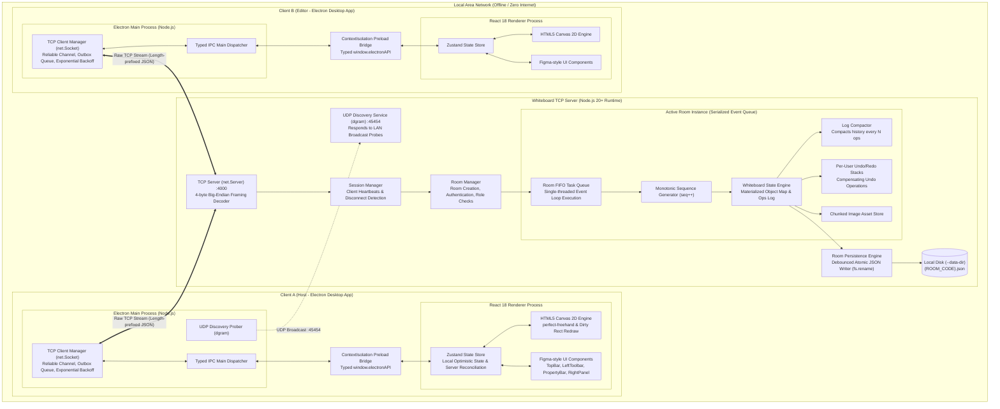
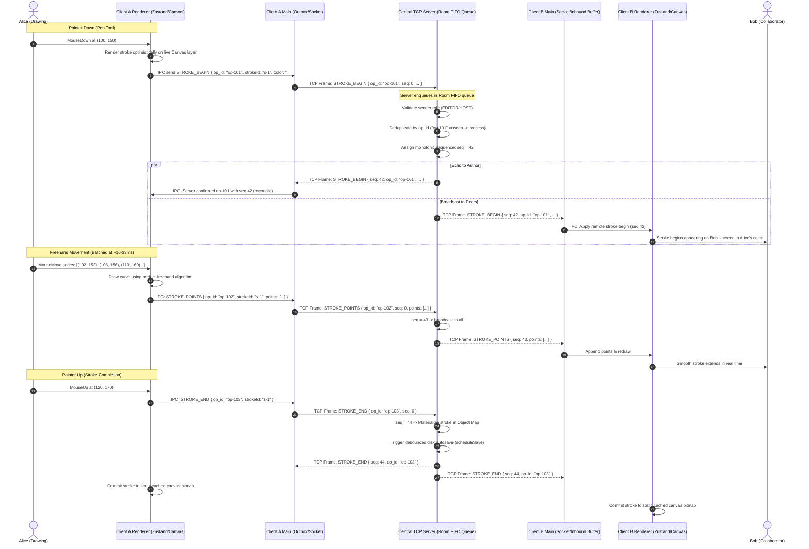
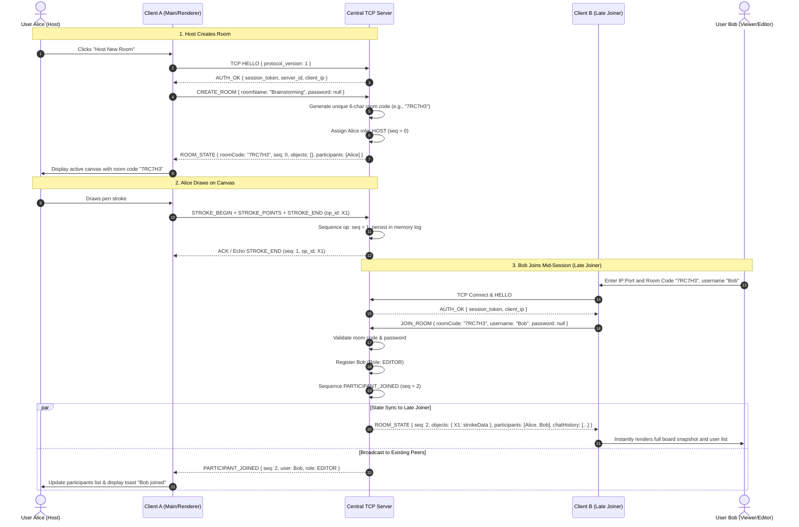
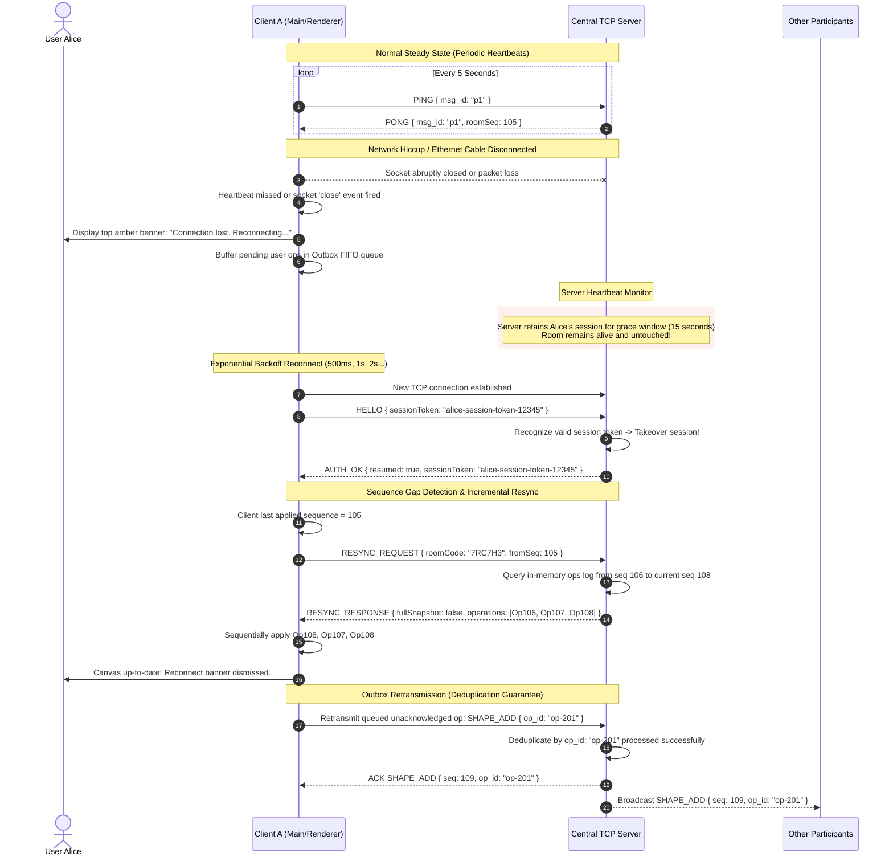

# System Architecture Specification

**Course**: CS3004 — Computer Networks Laboratory  
**Project**: LAN-Based Multi-User Collaborative Whiteboard

## 1. Executive Summary & Core Objectives

The **LAN-Based Multi-User Collaborative Whiteboard** is an offline-first, real-time shared workspace engineered for **CS3004 (Computer Networks)** to operate with zero dependencies on external cloud services, third-party synchronization APIs (such as Firebase), or high-level abstraction frameworks (such as WebSockets, Socket.IO, or HTTP servers).

All essential network communications operate over raw **Transmission Control Protocol (TCP)** sockets using native operating system socket facilities provided by Node.js (`net` module). LAN service discovery operates over **User Datagram Protocol (UDP)** broadcast sockets (`dgram` module).



---

## 2. Monorepo Structure & Package Decomposition

The codebase is organized as an npm workspace monorepo enforcing strict separation of concerns across three packages:

```text
CN_Project/
├── packages/
│   ├── common/                  # Shared protocol, framing, schemas, and domain models
│   │   ├── src/
│   │   │   ├── framing/         # 4-byte BE length-prefix encoder and stateful decoder
│   │   │   ├── protocol/        # Message envelopes, message types, object definitions
│   │   │   ├── schemas/         # Zod validation schemas for all inbound envelopes
│   │   │   ├── constants/       # Networking timeouts, buffer limits, role enums
│   │   │   └── types/           # Canonical TypeScript interfaces
│   │   └── tests/               # Framing fragmentation and coalescing unit tests
│   │
│   ├── server/                  # Central coordinator daemon
│   │   ├── src/
│   │   │   ├── server.ts        # Node.js net.Server listener and socket accept loop
│   │   │   ├── session.ts       # Per-connection socket wrapper, heartbeat watchdog
│   │   │   ├── room-manager.ts  # Room registry, code generation, password verification
│   │   │   ├── room.ts          # Single room state engine, FIFO task queue, sequencer
│   │   │   ├── room-persistence.ts # Debounced atomic JSON state persistence
│   │   │   ├── discovery.ts     # UDP broadcast responder
│   │   │   └── cli.ts           # Command-line interface with argument parsing
│   │   └── tests/               # Multi-client socket integration test suites
│   │
│   └── client/                  # Cross-platform desktop client (Electron + React)
│       ├── electron/
│       │   ├── main.ts          # Main process lifecycle, window creation, IPC dispatcher
│       │   ├── tcp-client.ts    # Reliable socket client, outbox queue, auto-reconnect
│       │   ├── discovery.ts     # UDP LAN prober for discovering local servers
│       │   └── preload.ts       # Context-isolated secure IPC bridge (electronAPI)
│       ├── src/
│       │   ├── components/      # UI layout (TopBar, Toolbar, PropertyBar, RightPanel)
│       │   ├── canvas/          # HTML5 Canvas 2D engine with perfect-freehand
│       │   ├── store/           # Zustand application store & optimistic state reducer
│       │   ├── hooks/           # Keyboard shortcut bindings & gesture hooks
│       │   └── export/          # PNG, PDF, and JSON export utilities
│       └── tests/               # UI rendering, tool manipulation, and export tests
│
├── tests/                       # Cross-cutting lossy network test harness
└── docs/                        # Specifications, user guide, diagrams, and reports
```

---

## 3. Network Architecture & Protocol Layering

### 3.1 Transport Protocol Justification (TCP vs. UDP)

The core communication layer uses **TCP (Transmission Control Protocol)** rather than UDP for the collaborative session data stream:

| Criterion                     | TCP (Our Choice)                                                                      | UDP                                                                                      |
| :---------------------------- | :------------------------------------------------------------------------------------ | :--------------------------------------------------------------------------------------- |
| **Reliability**               | Guaranteed in-kernel delivery with automatic ARQ retransmission and checksums.        | Unreliable; packet drops require complex custom retransmission logic.                    |
| **Ordering**                  | Stream bytes arrive in the exact order transmitted; no transport packet reordering.   | Datagrams arrive out-of-order; application layer must reassemble and buffer.             |
| **Flow & Congestion Control** | Sliding window prevents client socket buffer exhaustion during initial snapshot sync. | No flow control; high-speed snapshot bursts overflow receiver OS buffers.                |
| **Suitability for Mutations** | Ideal for discrete whiteboard operations (shapes, strokes, erases, text, chat).       | Ill-suited; losing an erase or shape-add operation leads to permanent canvas divergence. |

**UDP Usage**: UDP is utilized exclusively for **Zero-Configuration LAN Service Discovery** via broadcast (`dgram` on port `45454`). Clients broadcast discovery probes; listening servers respond with their TCP listening address and active room metadata.

### 3.2 Application-Level Framing: 4-Byte Big-Endian Length Prefix

Because TCP provides a continuous byte stream without packet boundaries, the application layer implements a framing protocol to handle fragmentation and coalescing:

```text
 0                   1                   2                   3
 0 1 2 3 4 5 6 7 8 9 0 1 2 3 4 5 6 7 8 9 0 1 2 3 4 5 6 7 8 9 0 1
+-+-+-+-+-+-+-+-+-+-+-+-+-+-+-+-+-+-+-+-+-+-+-+-+-+-+-+-+-+-+-+-+
|                 Payload Length (32-bit Big-Endian)            |
+-+-+-+-+-+-+-+-+-+-+-+-+-+-+-+-+-+-+-+-+-+-+-+-+-+-+-+-+-+-+-+-+
|                                                               |
|                   UTF-8 Encoded JSON Body                     |
|                      (Variable Length)                        |
|                                                               |
+-+-+-+-+-+-+-+-+-+-+-+-+-+-+-+-+-+-+-+-+-+-+-+-+-+-+-+-+-+-+-+-+
```

1. **Header**: Exactly 4 bytes (`UInt32BE`) specifying the byte length $L$ of the payload.
2. **Payload**: Exactly $L$ bytes of UTF-8 encoded JSON.
3. **Maximum Frame Size**: Capped at **8 MB (8,388,608 bytes)** to prevent denial-of-service memory exhaustion. Frames exceeding 8 MB result in immediate socket termination.
4. **Framing Decoder**: A stateful parser maintains an internal accumulator buffer:
   - If accumulated bytes $< 4$, wait for additional network chunks.
   - Once 4 bytes are available, read $L$. If accumulated bytes $< 4 + L$, wait for remaining fragments.
   - Once $4 + L$ bytes are present, slice the frame body, parse the JSON payload, and shift the buffer to parse any coalesced subsequent frames in a single event-loop turn.

### 3.3 Universal Message Envelope

Every application message conforms to the following schema:

$$\text{Envelope} = \{ v, \text{type}, \text{msg\_id}, \text{seq}, \text{ts}, \text{room}, \text{user\_id}, \text{payload} \}$$

- `v` (`number`): Protocol version (fixed to `1`). Handshake validates compatibility.
- `type` (`MessageType`): Message action discriminator (e.g., `STROKE_BEGIN`, `CHAT_MESSAGE`).
- `msg_id` (`UUIDv4`): Unique message identifier generated by the sender for tracking and request/response correlation.
- `seq` (`number`): Global monotonic sequence number assigned exclusively by the server to state-mutating operations. Set to `0` on unsequenced client transmissions.
- `ts` (`number`): Epoch millisecond timestamp assigned by the server.
- `room` (`string`): 6-character room identifier.
- `user_id` (`UUIDv4`): Unique user identifier.
- `payload` (`object`): Type-specific payload strictly validated using Zod schemas.

---

## 4. Concurrency Model & Server Event Loop Execution

The whiteboard server guarantees strong data consistency without multi-threaded lock contention by leveraging Node.js's single-threaded event loop combined with a **Per-Room FIFO Task Queue**:

```mermaid
flowchart TD
    InboundTCP["Inbound TCP Socket Chunk"] --> FrameDecoder["Framing Decoder"]
    FrameDecoder --> ZodValidator["Zod Schema Validation & Role Check"]
    ZodValidator -->|Invalid| DropReject["Send ERROR / Disconnect"]
    ZodValidator -->|Valid| Enqueue["Enqueue in Room Serial FIFO Queue"]

    subgraph SerialExecution["Per-Room Serial Execution (Single-Threaded Task Runner)"]
        Enqueue --> CheckDup{"op_id already<br/>processed?"}
        CheckDup -->|Yes (Duplicate)| EchoAck["Echo Cached ACK (Idempotent)"]
        CheckDup -->|No (New Op)| AssignSeq["Assign seq = ++room.seq"]
        AssignSeq --> MutateState["Mutate Materialized Object Map"]
        MutateState --> AppendLog["Append to In-Memory Ops Log"]
        AppendLog --> CheckCompact{"Log length ><br/>THRESHOLD?"}
        CheckCompact -->|Yes| Compact["Compact Log to Snapshot + Delta"]
        CheckCompact -->|No| Broadcast["Broadcast Framed Message to Peers"]
        Compact --> Broadcast
        Broadcast --> ScheduleSave["Schedule Debounced Autosave (300ms)"]
    end

    ScheduleSave --> AsyncFS["Async Disk Write (fs.writeFile + rename)"]
```

### 4.1 Strict Serialization Guarantee

Within any given room, mutations are wrapped in a promise-chained execution queue (`room.enqueue(task)`). Each mutation completes in its entirety—including sequence assignment, in-memory state modification, and broadcast preparation—before the next queued operation begins. This completely prevents race conditions and interleaving errors across concurrent clients.

### 4.2 Non-Blocking Disk I/O & Atomic Persistence

Disk operations never block the Node.js event loop:

- Room state changes trigger a **debounced write timer (300 ms)**.
- Persistence serializes the full state into temporary files (`{code}.json.tmp.{uuid}`) using asynchronous Node.js `fs/promises`.
- Once written and flushed, the file is moved to its final destination via atomic `fs.rename()`, guaranteeing that crashes or power loss never leave corrupted partial files on disk.

### 4.3 Backpressure Management & Bounded Sockets

To prevent slow network clients from causing unbounded memory growth on the server:

- Each connected session maintains a bounded outgoing frame buffer.
- The server inspects the boolean return value of `socket.write(buffer)`. When false, the server halts writing to that socket until the kernel emits the `'drain'` event.
- If a client's outbound buffer exceeds a high-water mark (e.g., during network stalling), the server drops non-essential ephemeral messages (such as `CURSOR_MOVE`) first. If buffer pressure persists, the server terminates the slow connection, prompting the client to reconnect and resync state cleanly.

---

## 5. Synchronization Strategy & Consistency Model

The application adopts an **Optimistic Client-Side Rendering with Server Reconciliation** synchronization model.



### 5.1 Monotonic Ordering (`seq`)

Every state mutation accepted by the server is assigned a continuous, gap-free positive integer $seq \in \{1, 2, 3, \dots\}$. Clients maintain a local pointer `lastAppliedSeq`. Incoming operations are applied strictly in ascending `seq` order.

### 5.2 Idempotency & Operation Deduplication (`op_id`)

Every client-originated operation carries a unique `op_id` (UUIDv4). The server tracks recently applied `op_id`s in a ring buffer. If a duplicate operation is received (e.g., due to client retransmission after a network pause), the server acknowledges the operation without re-executing it or altering the sequence counter.

### 5.3 Optimistic Rendering & Replay

When a user draws a stroke or moves a shape:

1. The local client renders the change immediately with zero latency.
2. The mutation is transmitted to the server with `seq: 0`.
3. When the server echoes the sequenced mutation back to the author, the local client reconciles the temporary optimistic state with the canonical server state.
4. If an operation is rejected by the server (e.g., due to role violation), the client reverts the optimistic state.

---

## 6. Late-Join State Synchronization & Log Compaction

When a participant connects to an ongoing session with hundreds of past operations:



1. **State Snapshot (`ROOM_STATE`)**: The server does **not** force late joiners to replay thousands of individual stroke point events. Instead, the server maintains a materialized in-memory `objects` dictionary.
2. Upon receiving `JOIN_ROOM`, the server transmits a single `ROOM_STATE` frame containing:
   - Current room sequence counter (`seq`).
   - Materialized object map (all live strokes, shapes, text, sticky notes, and image references).
   - Recent chat history (last 100 messages).
   - Active participant registry with roles and assigned colors.
3. **Log Compaction**: The server maintains an operation log of recent operations. When the operation log exceeds `MAX_LOG_SIZE` (1,000 operations), the server truncates operations older than the base snapshot sequence, preserving memory while ensuring sufficient history for incremental reconnects.

---

## 7. Fault Tolerance, Heartbeats & Recovery Mechanisms



### 7.1 Heartbeat Protocol & Silent Failure Detection

Standard TCP sockets do not immediately notify application code when an Ethernet cable is detached or a machine sleeps without sending a TCP `FIN` packet.

- **Client Heartbeat**: The client transmits a `PING` frame every **5,000 ms**.
- **Server Response**: The server answers with `PONG`, embedding the latest `roomSeq`.
- **Server Dead-Peer Detection**: If no data or PING is received from a client for **15,000 ms**, the server terminates the socket, broadcasts `PARTICIPANT_LEFT`, and preserves the room state.
- **Client Dead-Server Detection**: If no PONG is received for **10,000 ms**, the client declares the connection broken and initiates reconnect.

### 7.2 Session Takeover via Session Tokens

Upon initial authentication, the server generates a cryptographically random `sessionToken` (UUIDv4) and returns it in `AUTH_OK`. When reconnecting, the client presents this token in `HELLO`. The server verifies the token and re-binds the client to their existing participant session, preserving user identity, color, and role without creating a ghost user.

### 7.3 Gap Detection & Incremental Resync

If a client receives a message where $seq > lastAppliedSeq + 1$, or discovers via `PONG.roomSeq` that it missed updates:

1. The client buffers the out-of-order message.
2. The client transmits `RESYNC_REQUEST` specifying its `fromSeq`.
3. If the server has the requested delta in its log, it returns `RESYNC_RESPONSE` with the slice of missing operations.
4. If the gap is larger than the server's history window, the server returns a complete snapshot (`ROOM_STATE`), resetting the client to the canonical baseline.

---

## 8. Multi-User Undo/Redo Semantics

Undo and redo in a shared collaborative canvas present complex distributed consistency challenges. The application implements **Isolated Per-User Undo with Compensating Operations**:

```mermaid
sequenceDiagram
    autonumber
    actor Alice as Alice
    participant ClientA as Client A
    participant Server as Central TCP Server
    participant ClientB as Client B
    actor Bob as Bob

    Note over Alice,Bob: Shared Canvas Context: Alice added a Rectangle (ID: R1)
    Alice->>ClientA: Presses Ctrl+Z (Undo)
    ClientA->>ClientA: Pop target op from Alice's local undo stack -> Op adding R1
    ClientA->>Server: UNDO { op_id: "undo-1", target_op_id: "op-rect-1", target_object_id: "R1" }

    Note over Server: Server executes in Room FIFO Queue
    Server->>Server: Verify sender owns target op (Alice owns op-rect-1)
    Server->>Server: Check if R1 still exists and has not been mutated/deleted by another peer
    alt Object Exists and No Conflict
        Server->>Server: Sequence compensating UNDO op: seq = 75
        Server->>Server: Remove R1 from active objects map
        Server-->>ClientA: Broadcast UNDO { seq: 75, target_op_id: "op-rect-1", target_object_id: "R1" }
        Server-->>ClientB: Broadcast UNDO { seq: 75, target_op_id: "op-rect-1", target_object_id: "R1" }
        ClientA->>Alice: R1 disappears from canvas; push to Alice's redo stack
        ClientB->>Bob: R1 disappears from canvas; Bob's undo stack untouched!
    else Conflict / Already Deleted by Bob
        Server->>Server: Treat undo as harmless no-op
        Server-->>ClientA: ERROR / ACK { status: "no_op", message: "Target already modified or deleted" }
        ClientA->>Alice: Display unobtrusive toast: "Cannot undo: object was already modified"
    end
```

- **Per-User Isolation**: Alice's undo stack contains _only_ mutations created by Alice. Pressing `Ctrl+Z` never deletes or mutates Bob's work.
- **Compensating Operations**: An undo does not rewind global time. It generates a new forward-sequenced compensating operation referencing the target `op_id`.
- **Conflict Handling**: If Bob has already modified or erased the object Alice attempts to undo, the server recognizes the conflict, leaves the object unchanged, and returns an informational no-op status to Alice.

---

## 9. Security & Access Control Architecture

The server treats all connected clients as untrusted:

1. **Password Hashing**: Room passwords are never stored in plaintext. Passwords are salted and hashed using Node.js's native `crypto.scrypt` with 64-byte derived keys.
2. **Brute-Force Rate Limiting**: The server tracks failed join attempts by remote IP address. After 5 failed password attempts within a 60-second window, connections from that IP are throttled.
3. **Role-Based Access Control (RBAC)**:
   - **`HOST`**: Full administrative privileges (clear board, kick users, change user roles, toggle room lock, restore version snapshots, manual save/load).
   - **`EDITOR`**: Read and write privileges (draw, erase, insert shapes, add text, sticky notes, upload images, send chat).
   - **`VIEWER`**: Read-only privileges (receives real-time board updates, can pan/zoom and participate in text chat, but all canvas-mutating socket messages are rejected by the server).
4. **Input Validation**: All inbound message bodies are validated with strict **Zod schemas**. Out-of-range coordinates, malformed UUIDs, oversize point arrays, and unauthorized message types are rejected prior to execution.
